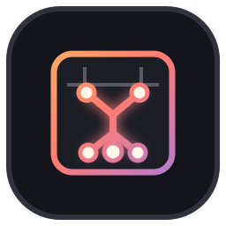
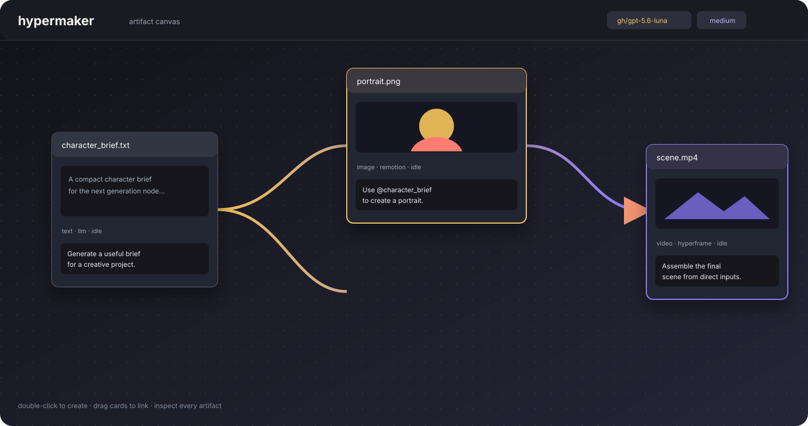

**English** | [简体中文](README.zh-CN.md)

> **Status: canvas usable, generation path verified (0.1.0, 2026-11-27).** `npm test` passes 38/38 when a usable Chromium is available; two cases render for real through Remotion (a PNG and an h264 MP4), one renders a real WAV and checks the player can report its length, three pin how an artifact records the materials it was made from, two pin how its audio is measured, seven cover the run lifecycle, and two drive Stop and a failed run in a real browser. The ordinary user path — create, type, move, overlap and raise, link by dragging one card onto another's title bar, right-click unlink, delete with confirmation, reopen — was exercised end to end in a real browser. One **real Codex CLI run** was also taken: the agent wrote and ran a script and returned a text artifact the canvas previewed. What is simulated and what is real is spelled out in [**Verification limits**](#verification-limits).

<div align="center">
  

  # Hypermaker

  ### A canvas for turning connected ideas into real artifacts. ✦

  <p><strong>A local-first node canvas where Codex writes the script, runs it, and hangs the resulting text, image, audio or video back on the graph — every prompt, script and output left readable on disk.</strong></p>

  <a href="LICENSE"></a>
</div>

<p align="center">
  
</p>

> **Status: local-canvas milestone (0.1.0).** The prototype reached its
> experimental goal; no further development is planned unless the project's
> inputs or goals change. [`docs/project-status.md`](docs/project-status.md) has the
> real-vs-simulated table and what a first run is like.

## Why Hypermaker?

Terminal-driven generation is powerful, but it hides the structure of the work. Hypermaker puts that structure on a canvas:

```text
idea -> node -> artifact -> connected node -> larger artifact
                            \- inspect / repair / regenerate
```

Each generation node has a prompt, named inputs, an output type, a generation method, a quality preset, a script, and a rendered artifact. The agent writes and runs the script, checks the result, and hands the artifact back to the canvas. Everything stays inspectable on disk.

No diffusion or DiT model is required. Hypermaker is deliberately about code-generated, renderable work: the kind of work an LLM can explain, modify, execute, and debug.

## Quick start

Requirements:

- Node.js 20 or newer
- An authenticated [Codex CLI](https://github.com/openai/codex) available as `codex` (or pointed to by `CODEX_BIN`)
- A local browser

```bash
git clone --recurse-submodules https://github.com/ZisIsNotZis/hypermaker.git
cd hypermaker
npm install
npm run dev
```

Open <http://127.0.0.1:8787>.

Double-click empty canvas to create a node. Choose its type, method and quality, write a prompt, and press **Generate**. While the agent works the card reads `running`, Generate becomes *Generating…*, and **Stop** appears; Stop ends the agent and everything it spawned, marks the card `cancelled`, and keeps the previous artifact. A failure puts its reason on the card. Drag one card onto another to make it an input; right-click the link to remove it. Every generated node gets its own directory under `.hypermaker/<id>/`.

The submodules in `vendor/` (the HyperFrames and Remotion skill sets) are what `.agents/skills/` symlinks into, so the `--recurse-submodules` clone is what makes agent skills resolve.

Server environment variables:

| Variable | Default | Meaning |
| --- | --- | --- |
| `PORT` | `8787` | HTTP port |
| `HYPERMAKER_HOST` | `127.0.0.1` | bind address |
| `HYPERMAKER_WORKDIR` | `<repo>/.hypermaker` | workspace directory |
| `CODEX_BIN` | `codex` | CLI to spawn (a `.mjs` path is run with the current Node) |

## What it can do today

- Build a DAG by dragging cards together; only direct inputs enter a downstream prompt.
- Generate plain UTF-8 text with the `llm` method.
- Generate still images and video with the `hyperframe` or `remotion` methods. Both are verified end to end through real Remotion renders (`test/media.test.mjs`, `demo` quality): a 320x180 PNG asserted by signature and by the loaded preview, and a 320x180 h264 MP4 asserted by container and by the `<video>` the browser decodes. Audio is wired but not yet backed by a real-generation test — see **Verification limits** below.
- Generate audio: the offline `synth` method writes a WAV with nothing installed (tones, chords, rhythm, sound effects), and `tts.cpp`/`bark.cpp` cover speech when those local binaries and a GGUF model exist.
- Pick a quality preset — `sketch`, `demo`, `standard`, `artistic`, `realistic` — which changes how much inspection and repair the agent does.
- Import an existing local file as a constant node (no method, no Generate); the file is copied into its node directory. Import is HTTP-only today (`POST /api/import`), like clone and relayout below.
- Run several generations concurrently, one per card; each card shows its own `draft` / `running` / `idle` / `cancelled` / `error` state over SSE. While a card is running it offers **Stop**, which ends the agent and everything it started; a second Generate on the same card is refused rather than starting a second agent.
- Read the reason a run stopped or failed on the card itself, including the agent's own last error message. The outcome is stored, so reopening the page or restarting the server does not turn a failure into a quiet draft.
- Inspect the exact prompt, script, artifact, `codex.jsonl` transcript and node-local `AGENTS.md` on disk after every run.
- Preview text, image, audio and video natively in the card, download the artifact, and delete a node (with confirmation) from the canvas.
- Work on overlapping cards: the card you touched last is drawn in front, and clicking a covered card's exposed edge brings it forward, so its controls stay reachable.
- Link lines are drawn in canvas space, so they stay attached to their cards through pan, zoom and drag.
- Pan the canvas by dragging empty space, zoom with the wheel (anchored at the pointer), and edit the prompt without the card losing focus or text.
- Clone and relayout through the HTTP API (`POST /api/clone`, `POST /api/layout`); the canvas UI does not expose buttons for these yet.

The registry is filesystem-driven. A new output type is a directory under `types/`, and a new method is a file `types/<type>/methods/<method>.mjs`; both are loaded at startup, so the harness has no per-type special cases.

### Verification limits

This section mixes two kinds of evidence, and they are marked as they appear:

- **Offline and free** - `npm test` and `node test/journey.mjs`. Every agent they use is a
  fixture (`test/fake-codex.mjs`, `test/fake-agent.mjs`, `test/fake-remotion-codex.mjs`,
  `test/fake-audio-codex.mjs`, `test/fake-film-codex.mjs`, `test/fake-poster-codex.mjs`).
  They need no model, no account and no network. Where a fixture still does real work -
  Remotion really bundles and renders, Chromium really decodes the result - it says so.
- **Subscription runs** - labelled "real Codex CLI run" wherever they appear. These spent a
  logged-in ChatGPT account on this machine (`codex-cli 0.172.0`), produce real artifacts,
  and each was a single run. They prove the contract and the plumbing, not output quality,
  and they are not reproducible without such an account.

- **Text** generation is exercised end to end against `test/fake-codex.mjs`, which writes the artifact a real agent would. Separately, one **real Codex CLI run** was taken on 2026-11-27 (`codex-cli 0.172.0`, ChatGPT auth): the agent wrote `generate.mjs`, ran it, and returned a plain-text artifact the canvas previewed (37 s, ~48k input tokens). That proves the adapter matches the real binary's `exec --json --output-last-message …` contract; it says nothing about output quality.
- **Image** generation is exercised end to end against `test/fake-remotion-codex.mjs`, which really bundles and renders with Remotion; the artifact is checked to be a real PNG. The "agent" is fake, the render is not. A **real Codex CLI run** also rendered a 1200x675 PNG whose preview the canvas showed. It is worth knowing what that run did: the agent produced a correct image, but it reached for a Playwright screenshot because the method guide never told it where a browser was, so Remotion could not start. The guide now names `HYPERMAKER_CHROME`/`CHROME_BIN`.
- **Video** generation is exercised end to end against the same fixture with `REMOTION_TEST_VIDEO=1`: Remotion bundles, selects, and calls `renderMedia` with h264, and the test asserts an `ftyp`/`avc1`/`moov` container plus a preview `<video>` that decodes 320x180 with a non-zero duration. Beyond the fixture, a **real Codex CLI run** took the generated poster as an input card, rendered a 720x404 h264 MP4 (3 s, 30 fps) from it - h264 needs even dimensions, so the requested 405 becomes 404, and the canvas played it — so a realistic composition is now covered once, by one run. What is still not proven is that the result is *good*: the fixture composition is two frames, and one real render says nothing about wording, pacing or how often a model picks sensible dimensions.
- **Audio** now has two halves with different standing. The **artifact path** is proven, including against a real model: `test/audio.test.mjs` drives a card whose agent writes a real 6-second 44.1 kHz mono PCM WAV with nothing installed, and asserts the RIFF header, the sample rate, that the data chunk size matches the bytes, that the samples are not silence, and that the canvas player reports the true length and can seek. Separately, a real Codex CLI run produced a 4-second WAV the canvas played (`0:00 / 0:04`) through the new offline `synth` method. **Speech synthesis is not proven**: `tts.cpp` and `bark.cpp` name binaries (`~/tts.cpp/build/bin/tts-cli`, `~/bark.cpp/build/examples/main/main`) that this machine does not have, so no speech run has been taken. `synth` produces tones, chords and rhythm, not words, and its guide says so.
- **A film from canvas material** is the headline outcome, and it was taken with the real
  CLI: a real poster card and a real 4-second WAV card were linked to one video card, the
  agent rendered a 720x404 h264 MP4, and the embedded audio measured **4.05 s, peak 11506,
  176739 non-zero samples** - audible sound inside the film, not a separate file beside it.
  `test/film.test.mjs` reproduces that shape with real Remotion renders on both sides. The
  trap this closed: a real agent earlier produced an MP4 with a valid AAC track of **pure
  digital silence** (peak 0), and every cheap check - MP4 container, audio stream present,
  the canvas plays it - passed. The video method guide now requires copying an audio input
  into `public/`, referencing it through `<Audio src={staticFile(...)}/>`, and **measuring
  the extracted track** before claiming audio. The first published peak for this film was 30496 and it was wrong: the measuring
script assumed the WAV `data` chunk starts at byte 44, but ffmpeg writes a `LIST` chunk
first, so 62 header bytes were counted as samples. Walking the chunk table gives **peak
11506** over 178752 samples, and its correlation with the source 4-second WAV is ~0.9997 -
that is the number to trust, and `test/wav.mjs` now parses chunks so the mistake cannot
quietly return.
- **Provenance** ("made from #1 image poster.png - #3 audio tone.wav") is a persisted
  snapshot, not a rendering of the current links, because links are the wrong source of
  truth in three ways. Each rule is pinned by a test in `test/sources.test.mjs` and each was
  checked by breaking the behaviour and watching it fail: the set is **frozen when the run
  starts** (a film takes minutes and the canvas can be rewired meanwhile); a link added
  mid-run is **kept**, since it is the person's preparation for the next run; and a re-run
  that **fails or is stopped** leaves the previous artifact's provenance alone, because that
  is still the artifact on the card. Sources are also identified by **map key, not by a
  record field**: a node read back from `workspace.yml` has no `id` of its own, so using
  `s.id` wrote `#null` for every source of a workspace loaded from disk - the ordinary case,
  since a film is usually made after a restart.
- **Media serving** used to break players in a way that was easy to miss: the file endpoint sent no `content-length` and ignored `Range`, so Chromium reported `duration: null` for a real WAV while an MP4 survived on its own `moov` box — video looked fine, audio looked broken, same cause. Worse, the failure depended on size: a 176 KB clip still reported a duration, a 352 KB one did not. The endpoint now sends a length, advertises `accept-ranges`, and answers `206` with the exact slice; `test/audio.test.mjs` fails (with `Infinity` as the reported duration) if that regresses.
`node test/chain.mjs` is the reproducible entry point for the film: it builds a poster, a WAV,
and then one film card that takes both as its materials, through the ordinary HTTP entry
point, and writes screenshots plus a JSON record of every checked fact. It spends real model
calls, so it is not part of `npm test`. It **exits non-zero** if the finished film's audio
measures silent, and again if the film does not record an audio source or that source is
itself silent - so its exit status is a usable verdict, not just "the agent came back".
Measured on the run recorded here: 4.05 s of audio, peak 11506 over 178739 non-silent
samples, tracking the source WAV at ~0.9997 correlation.
- **`hyperframe`** image/video and the quality presets are passed to the agent as guidance; they were not measured against a real model.
- **The run lifecycle** is covered by `test/lifecycle.test.mjs` and `test/stop-ui.test.mjs`: Stop kills the whole process group (checked against an agent that leaves a writing grandchild), a failure or a Stop is persisted and survives a restart, a run cut off with the server is reported as interrupted, and a missing CLI produces an instruction naming `CODEX_BIN`. Each of those was verified by breaking the behaviour and watching the test go red.
- `test/fake-codex.mjs` and `test/fake-agent.mjs` reproduce the contract (final artifact JSON, exit codes, error events), not the agent's judgment. Stop and a deliberately rejected model were additionally exercised through the real CLI; the rejected card carried the CLI's own message.

## The mental model

| Thing | Meaning |
| --- | --- |
| Card | One artifact-producing or imported node on the canvas |
| Input | A named direct link from another node; only direct inputs enter the prompt |
| Prompt | Human intent, combined with shared, type, method and quality guidance plus context |
| Script | The reproducible source the agent wrote for the artifact |
| Artifact | The actual output shown in the card preview |
| `workspace.yml` | The whole graph: position, inputs, type, method, prompt, quality, script, artifact per integer node id |
| `AGENTS.md` | Node-local memory for future generations in that node; empty when nothing is worth remembering |
| `codex.jsonl` | Raw Codex stdout/stderr for the run, kept for inspection only |

Imported files are copied into their new node directory, and they stay constant: no method, no Generate, no longer pointing at the original path. Draft nodes have no directory until the first Generate. The agent may choose an informative artifact filename; the harness rejects any path that escapes the node directory or whose extension does not match the node's type.

## Repository map

```text
server/index.mjs       local HTTP + SSE harness and route table
server/codex.mjs       Codex CLI adapter: one process per node, result validation
server/prompt.mjs      assembles the sectioned prompt from a node and its inputs
server/registry.mjs    filesystem type/method registry
server/workspace.mjs   workspace.yml serialization, atomic write, path safety
public/index.html      single-file canvas UI (drag, link, pan, zoom, preview)
prompts/               fixed prompt blocks: shared, output-*, type-*, quality-*
types/                 text, image, audio, video definitions + methods
test/                  node:test suites and fake Codex binaries
vendor/                pinned submodules: hyperframes, remotion skills
docs/                  design.md, impl.md, project-status.md
```

How the pieces talk: the browser sends JSON commands over HTTP, the server mutates the in-memory graph and rewrites `workspace.yml` atomically, and generation results come back as SSE events (`started`, `complete`, `error`) that make the canvas reload. Generation spawns the Codex CLI from the repository root — so `.agents` skills load — with the node directory in `HYPERMAKER_NODE_DIR`; the process writes `codex.jsonl` and a final JSON file, and the harness reads only that final file, validates the artifact, and records it in the workspace.

Project source of truth: [`docs/design.md`](docs/design.md) for product behavior, [`docs/impl.md`](docs/impl.md) for architecture. Agents read [`AGENTS.md`](AGENTS.md) first.

## How to develop

```bash
npm install          # Node.js 20+, installs Playwright and the Remotion packages
npm test             # unit + canvas-script + browser + lifecycle tests on fake agents
npm run test:e2e     # canvas tests only; needs a Chromium Playwright can launch
node --check server/index.mjs
git diff --check
```

`npm test` uses `test/fake-codex.mjs`, `test/fake-agent.mjs` and their siblings, so it needs no model access and no credentials. In the tests, set `HYPERMAKER_RESET_WORKSPACE=1` to start from an empty graph.

The browser tests launch Chromium through `test/browser.mjs`. If `npx playwright install` is not an option, point the helper at a Chromium you already have:

```bash
HYPERMAKER_CHROME=/path/to/chrome npm test
```

`CHROME_BIN` works as a fallback. Without either variable Playwright uses its bundled browser, and a missing bundle is reported as `Executable doesn't exist`. The browser tests build every fixture from scratch on a fresh workspace, so they need no network and no credentials.

`node test/journey.mjs` is not part of `npm test`: it walks the ordinary-user path once — create, type, overlap, raise, move, link, unlink, generate, reopen, delete — and screenshots each step into `.tmp/journey/` (or `HYPERMAKER_SHOTS`). It prints, as JSON, what it did at each step, so a person can look at the pictures and the facts instead of reading assertions.

## How to contribute

Small, focused changes are easiest to review. Read [`AGENTS.md`](AGENTS.md), [`docs/design.md`](docs/design.md) and [`docs/impl.md`](docs/impl.md) first, keep type/method behavior under `types/`, add a focused regression test for behavior you change, and update the source-of-truth doc when behavior changes. Full rules are in [`CONTRIBUTING.md`](CONTRIBUTING.md).

```bash
git checkout -b feat/your-idea
npm test
git diff --check
```

## Roadmap

**Implemented (0.1.0)**

- Integer-id node graph persisted as one `workspace.yml`, atomic writes, node-local paths.
- Filesystem registry with four output types and six methods (`llm`, `remotion`, `hyperframe`, `synth`, `tts.cpp`, `bark.cpp`); an artifact also records the materials it was made from.
- Concurrent async generation through the Codex CLI, one run per node, with per-node status over SSE, a real Stop, persisted outcomes and validated artifact/script output.
- Canvas: create, drag, link, unlink, pan, zoom, preview, download, delete-with-confirmation, import.
- Deterministic tests plus a Playwright browser suite running against fake Codex binaries.

**Deferred / not planned right now**

- More output types and generation methods.
- Richer graph editing (multi-select, undo, dependency-aware relayout), richer media metadata, collaboration.
- Benchmarks, a video, or a paper — none were produced and none are in scope for this milestone.

The registry boundary exists so that a future experiment (a new type, a different agent) does not require rewriting the core. If someone picks the project up, that is the seam to start from.

## License

Hypermaker is free software under the [GNU Affero General Public License v3.0 or later](LICENSE).

<div align="center">
  <br />
  <strong>Connect the work. Keep the source. Ship the artifact.</strong>
</div>
