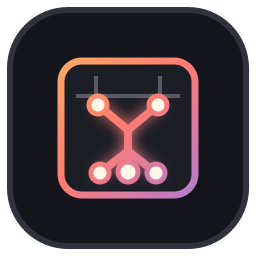

[English](README.md) | **简体中文**

<div align="center">
  

  # Hypermaker

  ### 把相连的想法变成真实产物的画布。✦

  <p><strong>一块本地优先的节点画布：Codex 写脚本、跑脚本，再把生成的文本、图片、音频或视频挂回图上——每个提示词、脚本和产物都原样留在磁盘上，随手可查。</strong></p>

  <a href="LICENSE"></a>
</div>

<p align="center">
  
</p>

> **状态：画布可用，生成链路已验证，旧版本会保留（0.1.0，2026-11-27）。** 配可用 Chromium 时 `npm test` 为 44/44；其中两条用 Remotion 真渲染（一张 PNG、一个 h264 MP4），七条覆盖生成生命周期，两条在真实浏览器里驱动 Stop 和一次失败，四条固定「重跑不会弄丢你已经认可的版本」：失败的一版留着旧成片和旧来源、第二版可播且认得出自己用的素材、渲染中途换素材不影响结果、重开后版本还在而正在生成的卡拒绝回退。普通使用者路径（新建、输入、移动、重叠后抬升、拖到另一张卡标题栏上连线、右键断线、删除确认、重新打开）已在真实浏览器里逐步走通。此外还跑通了一次**真实 Codex CLI** 生成：代理自己写脚本、跑脚本，交回的文本产物被画布正常预览。哪些是模拟、哪些是真的，见下方**验证边界**。
>
> **状态：本地画布里程碑（0.1.0）。** 这个原型已经达成实验目标；除非项目的输入或目标发生变化，否则不再计划开发。[`docs/project-status.md`](docs/project-status.md) 里有“真实/模拟”对照表和首次接入的体验。

## 为什么要 Hypermaker？

终端里生成东西很强，但它把工作的结构藏起来了。Hypermaker 把结构摆到画布上：

```text
想法 -> 节点 -> 产物 -> 相连的节点 -> 更大的产物
                      \- 检查 / 修复 / 重新生成
```

每个生成节点都带着提示词、具名输入、输出类型、生成方法、质量档位、脚本和渲染出的产物。代理自己写脚本、跑脚本、检查结果，再把产物交回画布。所有东西都留在磁盘上，可查可改。

这里不需要扩散模型或 DiT 模型。Hypermaker 只关心由代码生成、可渲染的工作——那种大模型能解释、能修改、能执行、能调试的工作。

## 快速开始

环境要求：

- Node.js 20 或更新版本
- 已登录的 [Codex CLI](https://github.com/openai/codex)，命令名为 `codex`（也可以用 `CODEX_BIN` 指定）
- 本地浏览器

```bash
git clone --recurse-submodules https://github.com/ZisIsNotZis/hypermaker.git
cd hypermaker
npm install
npm run dev
```

打开 <http://127.0.0.1:8787>。

在空白画布上双击即可新建节点：选好类型、方法和质量档位，写下提示词，点 **Generate**。代理工作期间卡片显示 `running`，Generate 变成 *Generating…* 并出现 **Stop**；按下 Stop 会结束代理及其启动的整个进程组，卡片标为 `cancelled` 并保留上一份产物。失败时原因直接写在卡片上。把一张卡片拖到另一张卡片上就建立输入关系，右键连线可以取消。每个生成过的节点都会在 `.hypermaker/<id>/` 下拥有自己的目录。

`vendor/` 里的子模块（HyperFrames 与 Remotion 的 skill 集合）正是 `.agents/skills/` 里那些符号链接指向的东西，所以要带上 `--recurse-submodules` 克隆，代理的 skill 才能解析到。

服务端环境变量：

| 变量 | 默认值 | 含义 |
| --- | --- | --- |
| `PORT` | `8787` | HTTP 端口 |
| `HYPERMAKER_HOST` | `127.0.0.1` | 监听地址 |
| `HYPERMAKER_WORKDIR` | `<repo>/.hypermaker` | 工作区目录 |
| `CODEX_BIN` | `codex` | 要启动的命令（给 `.mjs` 路径时用当前 Node 直接运行） |

## 现在能做什么

- 拖动卡片彼此相连，搭出 DAG；只有直接输入会进入下游提示词。
- 用 `llm` 方法生成纯 UTF-8 文本。
- 用 `hyperframe` 或 `remotion` 方法生成静态图片和视频。两者都有真实的端到端证据（`test/media.test.mjs`，`demo` 档位）：320x180 的真 PNG，按签名和已加载的预览断言；320x180 的 h264 MP4，按容器结构和浏览器真的能解码的 `<video>` 断言。音频已接线但还没有真实生成测试，见下方**验证边界**。
- 用本地 `tts.cpp` 或 `bark.cpp` 方法生成 WAV/MP3/OGG 语音。
- 选择质量档位——`sketch`、`demo`、`standard`、`artistic`、`realistic`——它决定代理检查与返工的力度。
- 把本地已有文件导入成常量节点（没有方法、不能 Generate），文件会复制进该节点目录。
- 多个生成任务可并发进行，每个卡片同时只跑一个；每张卡片通过 SSE 显示自己的 `draft` / `running` / `idle` / `cancelled` / `error` 状态。运行中的卡片会出现 **Stop**，按下它会连带结束代理启动的整个进程树；同一张卡再点 Generate 会被拒绝，不会偷偷起第二个代理。
- 停止或失败的原因直接写在卡片上，包括代理自己的最后一条错误。运行结果会落盘，重开页面或重启服务都不会把一次失败变成安静的草稿。
- 每次运行后都能在磁盘上看到完整的提示词、脚本、产物、`codex.jsonl` 记录和该节点自己的 `AGENTS.md`。
- 在卡片里直接预览文本、图片、音频和视频，下载产物，确认后删除节点。
- 处理互相重叠的卡片：最后动过的那张画在最前，点击被压住卡片露出的边缘就能把它抬到最前，之后它的控件照常可用。
- 连线画在画布坐标系里，平移、缩放和拖卡片时始终贴在卡片边上。
- 拖空白处平移画布，滚轮以指针为中心缩放；写提示词时卡片不会失去焦点或丢字。
- 通过 HTTP 接口克隆节点、重排布局（`POST /api/clone`、`POST /api/layout`）；画布界面目前还没给这两个按钮。

注册表由文件系统驱动：新输出类型就是 `types/` 下的一个目录，新方法就是一个 `types/<type>/methods/<method>.mjs` 文件，启动时统一加载，所以 harness 里没有任何按类型写的特例分支。

## 概念模型

| 东西 | 含义 |
| --- | --- |
| 卡片 | 画布上一个生成型或导入型节点 |
| 输入 | 来自另一个节点的一条直接连线；只有直接输入会写进提示词 |
| 提示词 | 人的意图，加上共享、类型、方法和质量指引以及上下文 |
| 脚本 | 代理为这个产物写下的可复现源码 |
| 产物 | 卡片预览里看到的那份实际输出 |
| `workspace.yml` | 整张图：按整数节点 id 保存位置、输入、类型、方法、提示词、质量、脚本、产物 |
| `AGENTS.md` | 节点自己的记忆，供后续生成参考；没什么可记时留空 |
| `codex.jsonl` | 该次运行的 Codex 原始 stdout/stderr，只用于排查 |

导入的文件会被复制进新的节点目录，并从此保持不变：没有方法、不能 Generate、也不再指向原路径。草稿节点在第一次 Generate 之前没有目录。产物文件名可以由代理自己起，但 harness 会拒绝逃出节点目录的路径，以及扩展名与节点类型不符的产物。

## 仓库结构

```text
server/index.mjs       本地 HTTP + SSE harness 与路由表
server/codex.mjs       Codex CLI 适配层：每节点一个进程，校验结果
server/prompt.mjs      按节点及其直接输入拼装分节提示词
server/registry.mjs    文件系统类型/方法注册表
server/workspace.mjs   workspace.yml 序列化、原子写入、路径安全
public/index.html      单文件画布界面（拖拽、连线、平移、缩放、预览）
prompts/               固定提示词块：shared、output-*、type-*、quality-*
types/                 text、image、audio、video 定义与方法
test/                  node:test 测试套件与假的 Codex 可执行文件
vendor/                固定的子模块：hyperframes、remotion skills
docs/                  design.md、impl.md、project-status.md
```

各部分怎么协作：浏览器通过 HTTP 发 JSON 命令，服务端改动内存里的图并原子地重写 `workspace.yml`；生成结果以 SSE 事件（`started`、`complete`、`error`）回来，让画布重新加载。生成时从仓库根目录启动 Codex CLI——这样 `.agents` 里的 skill 才加载得到——节点目录通过 `HYPERMAKER_NODE_DIR` 传过去；子进程写出 `codex.jsonl` 和一个最终 JSON 文件，harness 只读那个最终文件，校验产物后记进工作区。

项目的事实来源：[`docs/design.md`](docs/design.md) 管产品行为，[`docs/impl.md`](docs/impl.md) 管实现架构。代理先读 [`AGENTS.md`](AGENTS.md)。

## 如何开发

```bash
npm install          # Node.js 20+，会安装 Playwright 与 Remotion 相关包
npm test             # 单元 + 画布脚本 + 浏览器测试，全部用假 Codex
npm run test:e2e     # 只跑画布测试，需要 Playwright 能启动的 Chromium
node --check server/index.mjs
git diff --check
```

`npm test` 用的是 `test/fake-codex.mjs` 及其同类假实现，不需要任何模型访问。测试时设 `HYPERMAKER_RESET_WORKSPACE=1` 可以从空图开始。

浏览器测试通过 `test/browser.mjs` 启动 Chromium。如果不想跑 `npx playwright install`，可以指向本机已有的浏览器：

```bash
HYPERMAKER_CHROME=/path/to/chrome npm test
```

`CHROME_BIN` 也可以作为后备。两个变量都不设时用 Playwright 自带的浏览器；自带浏览器缺失会报 `Executable doesn't exist`。浏览器测试都在全新的工作区里从零搭夹具，不需要联网，也不需要任何凭据。

`node test/journey.mjs` 不在 `npm test` 里：它只完整走一遍普通使用者路径——新建、输入、重叠、抬升、移动、连线、断线、生成、重新打开、删除——每步截一张图到 `.tmp/journey/`（可用 `HYPERMAKER_SHOTS` 改目录），并把每步实际发生了什么以 JSON 打印出来。人可以同时看图和事实，而不用读断言。

## 如何参与

小而专注的改动最容易评审。先读 [`AGENTS.md`](AGENTS.md)、[`docs/design.md`](docs/design.md) 和 [`docs/impl.md`](docs/impl.md)；类型/方法的行为放在 `types/` 下；改动了行为就补一个针对性的回归测试；行为变了就同步更新事实来源文档。完整规则见 [`CONTRIBUTING.md`](CONTRIBUTING.md)。

```bash
git checkout -b feat/your-idea
npm test
git diff --check
```

## 路线图

**已实现（0.1.0）**

- 以整数 id 为键的节点图，单个 `workspace.yml` 持久化，原子写入，节点内路径约束。
- 文件系统注册表：四种输出类型、五个方法（`llm`、`remotion`、`hyperframe`、`tts.cpp`、`bark.cpp`）。
- 通过 Codex CLI 并发异步生成，每节点同时只跑一个；按节点经 SSE 汇报状态，可真正 Stop，运行结果落盘，产物与脚本经过校验。
- 画布：新建、拖动、连线、取消连线、平移、缩放、预览、下载、确认删除（导入目前只有 HTTP 接口 `POST /api/import`，画布上没有按钮）。
- 确定性测试，以及一套跑在假 Codex 上的 Playwright 浏览器测试。

**暂缓 / 目前不计划**

- 更多输出类型与生成方法。
- 更完整的图编辑（多选、撤销、按依赖重排）、更丰富的媒体元数据、协作。
- 基准测试、视频或论文——这个里程碑没有产出，也不在范围内。

注册表这层边界的存在，是为了让以后的实验（新类型、换一个代理）不必重写核心。如果有人接手，就从这条缝开始。

### 验证边界

以下都是本地、离线运行能拿到的证据，没有用到付费模型或真实凭据。

- **文本**：对着 `test/fake-codex.mjs` 跑通全流程，夹具写出的产物与真实代理同形。另有一次**真实 Codex CLI** 运行（2026-11-27，`codex-cli 0.172.0`，ChatGPT 登录）：代理写了 `generate.mjs`、跑出 `.txt`，画布正常预览（37 秒，约 4.8 万输入 token）。这证明适配器与真实二进制的 `exec --json --output-last-message …` 契约一致，不证明输出质量。
- **图片**：对着 `test/fake-remotion-codex.mjs` 跑通全流程；这个夹具真的 bundle 并用 Remotion 渲染，产物被验证为真 PNG。假的只是“代理”，渲染是真的。
- **视频**：同一个夹具在 `REMOTION_TEST_VIDEO=1` 下真的走完 bundle、select、`renderMedia`（h264），用例断言 `ftyp`/`avc1`/`moov` 容器结构，以及画布里的 `<video>` 能解码出 320x180、时长非零。这证不了的是：一个更像真实作品的合成（更长时长、真正选过编码参数）能否照预期渲出来——链路是真的，创作判断是夹具给的。
- **音频**（`tts.cpp`、`bark.cpp`）仍没有真实生成测试：方法说明在，但还没有一次 TTS 运行被当作证据，请把这条路径视为未验证。
- 首次接入会碰到的两个边界：`vendor/` 是两个子模块，不带 `--recurse-submodules` 克隆时 `.agents/skills` 的链接会断，画布照常能用但代理拿不到 Remotion/HyperFrames 的 skill 知识；顶栏默认模型 id（`gpt-5.6-luna`）是本机账号可用的，换账号可能需要换 id，换了不支持的时候卡片上会直接写出 CLI 的报错。
- **`hyperframe`** 的图片/视频与质量档位是交给代理的指导，没有对着真实模型量过。
- **生成生命周期**由 `test/lifecycle.test.mjs` 与 `test/stop-ui.test.mjs` 覆盖：Stop 结束整个进程组（用会持续写标记的孙进程验证）、失败与停止结果落盘且重启后仍在、服务中断的运行会报“被打断”、缺少 CLI 时给出指向 `CODEX_BIN` 的可操作提示。每一条都靠“把对应行为改坏、看测试变红”核对过。
- `test/fake-codex.mjs` 与 `test/fake-agent.mjs` 复现的是契约（最终产物 JSON、退出码、错误事件），不是代理的判断力。Stop 和一次被拒的模型也通过真实 CLI 跑过，被拒的卡片上显示的就是 CLI 自己的报错。

## 许可证

Hypermaker 是自由软件，采用 [GNU Affero 通用公共许可证 v3.0 或更新版本](LICENSE)。

<div align="center">
  <br />
  <strong>连起工作，留住源码，交付产物。</strong>
</div>
