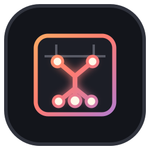
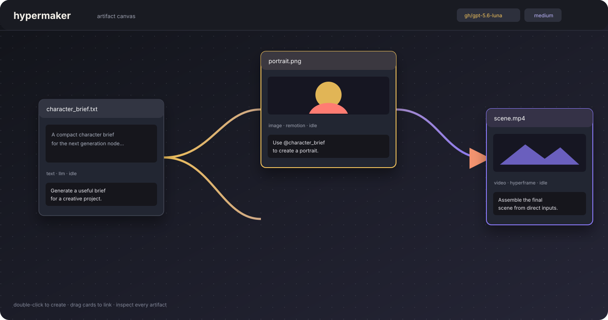

[English](README.md) | **简体中文**

<div align="center">
  

  # Hypermaker

  ### 把相连的想法变成真实产物的画布。✦

  <p><strong>一块本地优先的节点画布：Codex 写脚本、跑脚本，再把生成的文本、图片、音频或视频挂回图上——每个提示词、脚本和产物都原样留在磁盘上，随手可查。</strong></p>

  <a href="LICENSE"></a>
</div>

<p align="center">
  
</p>

> **状态：已收尾的里程碑（0.1.0）。** 这个原型已经达成实验目标；除非项目的
> 输入或目标发生变化，否则不再计划开发。见 [`docs/project-status.md`](docs/project-status.md)。

## 为什么要 Hypermaker？

终端里生成东西很强，但它把工作的结构藏起来了。Hypermaker 把结构摆到画布上：

```text
想法 -> 节点 -> 产物 -> 相连的节点 -> 更大的产物
                      \- 检查 / 修复 / 重新生成
```

每个生成节点都带着提示词、具名输入、输出类型、生成方法、质量档位、脚本和渲染出的产物。代理自己写脚本、跑脚本、检查结果，再把产物交回画布。所有东西都留在磁盘上，可查可改。

这里不需要扩散模型或 DiT 模型。Hypermaker 只关心由代码生成、可渲染的工作——那种大模型能解释、能修改、能执行、能调试的工作。

## 快速开始

环境要求：

- Node.js 20 或更新版本
- 已登录的 [Codex CLI](https://github.com/openai/codex)，命令名为 `codex`（也可以用 `CODEX_BIN` 指定）
- 本地浏览器

```bash
git clone --recurse-submodules https://github.com/ZisIsNotZis/hypermaker.git
cd hypermaker
npm install
npm run dev
```

打开 <http://127.0.0.1:8787>。

在空白画布上双击即可新建节点：选好类型、方法和质量档位，写下提示词，点 **Generate**。把一张卡片拖到另一张卡片上就建立输入关系，右键连线可以取消。每个生成过的节点都会在 `.hypermaker/<id>/` 下拥有自己的目录。

`vendor/` 里的子模块（HyperFrames 与 Remotion 的 skill 集合）正是 `.agents/skills/` 里那些符号链接指向的东西，所以要带上 `--recurse-submodules` 克隆，代理的 skill 才能解析到。

服务端环境变量：

| 变量 | 默认值 | 含义 |
| --- | --- | --- |
| `PORT` | `8787` | HTTP 端口 |
| `HYPERMAKER_HOST` | `127.0.0.1` | 监听地址 |
| `HYPERMAKER_WORKDIR` | `<repo>/.hypermaker` | 工作区目录 |
| `CODEX_BIN` | `codex` | 要启动的命令（给 `.mjs` 路径时用当前 Node 直接运行） |

## 现在能做什么

- 拖动卡片彼此相连，搭出 DAG；只有直接输入会进入下游提示词。
- 用 `llm` 方法生成纯 UTF-8 文本。
- 用 `hyperframe` 或 `remotion` 方法生成静态图片和视频。
- 用本地 `tts.cpp` 或 `bark.cpp` 方法生成 WAV/MP3/OGG 语音。
- 选择质量档位——`sketch`、`demo`、`standard`、`artistic`、`realistic`——它决定代理检查与返工的力度。
- 把本地已有文件导入成常量节点（没有方法、不能 Generate），文件会复制进该节点目录。
- 多个生成任务可并发进行；每张卡片通过 SSE 显示自己的 `draft` / `running` / `idle` / `error` 状态。
- 每次运行后都能在磁盘上看到完整的提示词、脚本、产物、`codex.jsonl` 记录和该节点自己的 `AGENTS.md`。
- 在卡片里直接预览文本、图片、音频和视频，下载产物，确认后删除节点。
- 通过 HTTP 接口克隆节点、重排布局（`POST /api/clone`、`POST /api/layout`）；画布界面目前还没给这两个按钮。

注册表由文件系统驱动：新输出类型就是 `types/` 下的一个目录，新方法就是一个 `types/<type>/methods/<method>.mjs` 文件，启动时统一加载，所以 harness 里没有任何按类型写的特例分支。

## 概念模型

| 东西 | 含义 |
| --- | --- |
| 卡片 | 画布上一个生成型或导入型节点 |
| 输入 | 来自另一个节点的一条直接连线；只有直接输入会写进提示词 |
| 提示词 | 人的意图，加上共享、类型、方法和质量指引以及上下文 |
| 脚本 | 代理为这个产物写下的可复现源码 |
| 产物 | 卡片预览里看到的那份实际输出 |
| `workspace.yml` | 整张图：按整数节点 id 保存位置、输入、类型、方法、提示词、质量、脚本、产物 |
| `AGENTS.md` | 节点自己的记忆，供后续生成参考；没什么可记时留空 |
| `codex.jsonl` | 该次运行的 Codex 原始 stdout/stderr，只用于排查 |

导入的文件会被复制进新的节点目录，并从此保持不变：没有方法、不能 Generate、也不再指向原路径。草稿节点在第一次 Generate 之前没有目录。产物文件名可以由代理自己起，但 harness 会拒绝逃出节点目录的路径，以及扩展名与节点类型不符的产物。

## 仓库结构

```text
server/index.mjs       本地 HTTP + SSE harness 与路由表
server/codex.mjs       Codex CLI 适配层：每节点一个进程，校验结果
server/prompt.mjs      按节点及其直接输入拼装分节提示词
server/registry.mjs    文件系统类型/方法注册表
server/workspace.mjs   workspace.yml 序列化、原子写入、路径安全
public/index.html      单文件画布界面（拖拽、连线、平移、缩放、预览）
prompts/               固定提示词块：shared、output-*、type-*、quality-*
types/                 text、image、audio、video 定义与方法
test/                  node:test 测试套件与假的 Codex 可执行文件
vendor/                固定的子模块：hyperframes、remotion skills
docs/                  design.md、impl.md、project-status.md
```

各部分怎么协作：浏览器通过 HTTP 发 JSON 命令，服务端改动内存里的图并原子地重写 `workspace.yml`；生成结果以 SSE 事件（`started`、`complete`、`error`）回来，让画布重新加载。生成时从仓库根目录启动 Codex CLI——这样 `.agents` 里的 skill 才加载得到——节点目录通过 `HYPERMAKER_NODE_DIR` 传过去；子进程写出 `codex.jsonl` 和一个最终 JSON 文件，harness 只读那个最终文件，校验产物后记进工作区。

项目的事实来源：[`docs/design.md`](docs/design.md) 管产品行为，[`docs/impl.md`](docs/impl.md) 管实现架构。代理先读 [`AGENTS.md`](AGENTS.md)。

## 如何开发

```bash
npm install          # Node.js 20+，会安装 Playwright 与 Remotion 相关包
npm test             # 确定性 harness/注册表/工作区测试，用假的 Codex
npm run test:e2e     # 画布测试，需要 Playwright 能启动的 Chromium
node --check server/index.mjs
git diff --check
```

`npm test` 用的是 `test/fake-codex.mjs` 及其同类假实现，不需要任何模型访问。测试时设 `HYPERMAKER_RESET_WORKSPACE=1` 可以从空图开始。

## 如何参与

小而专注的改动最容易评审。先读 [`AGENTS.md`](AGENTS.md)、[`docs/design.md`](docs/design.md) 和 [`docs/impl.md`](docs/impl.md)；类型/方法的行为放在 `types/` 下；改动了行为就补一个针对性的回归测试；行为变了就同步更新事实来源文档。完整规则见 [`CONTRIBUTING.md`](CONTRIBUTING.md)。

```bash
git checkout -b feat/your-idea
npm test
git diff --check
```

## 路线图

**已实现（0.1.0）**

- 以整数 id 为键的节点图，单个 `workspace.yml` 持久化，原子写入，节点内路径约束。
- 文件系统注册表：四种输出类型、五个方法（`llm`、`remotion`、`hyperframe`、`tts.cpp`、`bark.cpp`）。
- 通过 Codex CLI 并发异步生成，按节点经 SSE 汇报状态，产物与脚本经过校验。
- 画布：新建、拖动、连线、取消连线、平移、缩放、预览、下载、确认删除、导入。
- 确定性测试，以及一套跑在假 Codex 上的 Playwright 浏览器测试。

**暂缓 / 目前不计划**

- 更多输出类型与生成方法。
- 更完整的图编辑（多选、撤销、按依赖重排）、更丰富的媒体元数据、协作。
- 基准测试、视频或论文——这个里程碑没有产出，也不在范围内。

注册表这层边界的存在，是为了让以后的实验（新类型、换一个代理）不必重写核心。如果有人接手，就从这条缝开始。

## 许可证

Hypermaker 是自由软件，采用 [GNU Affero 通用公共许可证 v3.0 或更新版本](LICENSE)。

<div align="center">
  <br />
  <strong>连起工作，留住源码，交付产物。</strong>
</div>
