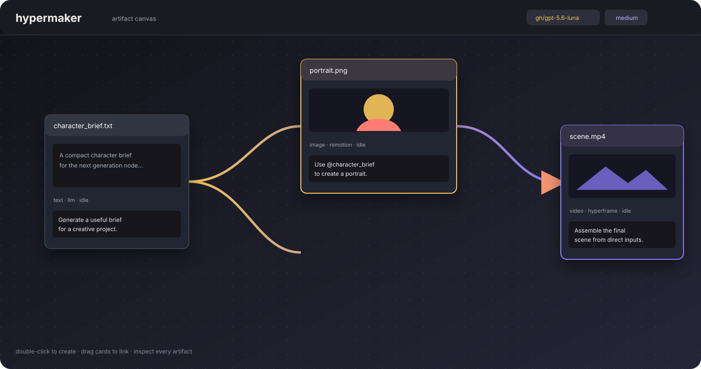

[English](README.md) | **简体中文**

<div align="center">
  

  # Hypermaker

  ### 把相连的想法变成真实产物的画布。✦

  <p><strong>一块本地优先的节点画布：Codex 写脚本、跑脚本，再把生成的文本、图片、音频或视频挂回图上——每个提示词、脚本和产物都原样留在磁盘上，随手可查。</strong></p>

  <a href="LICENSE"></a>
</div>

<p align="center">
  
</p>

> **状态：一次普通的创作过程可以走通，测试现在跟的就是这个过程（0.1.0，2026-11-27）。** 你能用画布上的素材做一支片子、换素材、留住已经认可的那一版、把两版放在一起比、回到其中一版，并且在失败、Stop 或重启之后仍然留住你喜欢的那版。配可用 Chromium 时 `npm test` 为 **185/185**；其中两条用 Remotion 真渲染（一张 PNG、一个 h264 MP4），七条覆盖生成生命周期，两条在真实浏览器里驱动 Stop 和一次失败，八条固定「重跑不会弄丢你已经认可的版本、也不会把它的来龙去脉写错」：失败的一版留着旧成片和旧来源、第二版可播且认得出自己用的素材、渲染中途换素材不影响结果、重开后版本还在、正在生成的卡拒绝回退，**交回旧文件的运行必须失败、而真的重渲染且字节相同仍算新一版**，保留的版本记得当时那条提示词、回到旧版时提示词跟着一起回去，两次生成得到 v1 和 v2 而不是两个 v1；两版可以并排一起看（不改变卡片当前显示哪一版），并且**同一时刻只有一路声音**：点开一版播放，另一版会自动停下，所以两版带旁白的成片能用耳朵分辨，而不只是看画面——这一点是走短片流程时发现的，之前在对照面板里两版会一起响；升级后新旧版本混在一张卡上时，无法查证的旧指令仍显示为未知、不会借用被替换那一版的指令，而你正在写的草稿不会被回退弄丢。普通使用者路径（新建、输入、移动、重叠后抬升、拖到另一张卡标题栏上连线、右键断线、删除确认、重新打开）已在真实浏览器里逐步走通。此外还跑通了一次**真实 Codex CLI** 生成：代理自己写脚本、跑脚本，交回的文本产物被画布正常预览。此外还多出一条垂直切片：画布上一张文本卡的文字，用本仓自带的离线嗓音念成旁白，再连进一支用 Remotion 真渲的成片；成片自己的音轨被抽出来用同一把尺量过，重启后卡片上还写得出念的是哪几句、读的是哪张卡，以及音频和这段文字对不对得上（服务端会按时间线重渲一遍再比，不只看时长）。哪些是模拟、哪些是真的，见下方**验证边界**。
>
> **状态：0.1.0，仍在开发。** 这不是一个已经关停的实验。画布和生成链路可用、有测试覆盖；接下来要做的是证据而不是功能：成片质量没人评过，离线嗓音量过但机械、**自然嗓音**从没真正跑过，`realistic` 档位没测过。另外有一条真实的缺口：重试、停止和清理都碰不到你放在卡片旁的文件，但代理本身能碰到。详见 [`docs/project-status.md`](docs/project-status.md)。

## 为什么要 Hypermaker？

终端里生成东西很强，但它把工作的结构藏起来了。Hypermaker 把结构摆到画布上：

```text
想法 -> 节点 -> 产物 -> 相连的节点 -> 更大的产物
                      \- 检查 / 修复 / 重新生成
```

每个生成节点都带着提示词、具名输入、输出类型、生成方法、质量档位、脚本和渲染出的产物。代理自己写脚本、跑脚本、检查结果，再把产物交回画布。所有东西都留在磁盘上，可查可改。

这里不需要扩散模型或 DiT 模型。Hypermaker 只关心由代码生成、可渲染的工作——那种大模型能解释、能修改、能执行、能调试的工作。

## 快速开始

环境要求：

- Node.js 20 或更新版本
- 已登录的 [Codex CLI](https://github.com/openai/codex)，命令名为 `codex`（也可以用 `CODEX_BIN` 指定）
- 本地浏览器

```bash
git clone --recurse-submodules https://github.com/ZisIsNotZis/hypermaker.git
cd hypermaker
npm install
npm run dev
```

打开 <http://127.0.0.1:8787>。

在空白画布上双击即可新建节点：选好类型、方法和质量档位，写下提示词，点 **Generate**。代理工作期间卡片显示 `running`，Generate 变成 *Generating…* 并出现 **Stop**；按下 Stop 会结束代理及其启动的整个进程组，卡片标为 `cancelled` 并保留上一份产物。失败时原因直接写在卡片上。把一张卡片拖到另一张卡片上就建立输入关系，右键连线可以取消。每个生成过的节点都会在 `.hypermaker/<id>/` 下拥有自己的目录。

`vendor/` 里的子模块（HyperFrames 与 Remotion 的 skill 集合）正是 `.agents/skills/` 里那些符号链接指向的东西，所以要带上 `--recurse-submodules` 克隆，代理的 skill 才能解析到。

服务端环境变量：

| 变量 | 默认值 | 含义 |
| --- | --- | --- |
| `PORT` | `8787` | HTTP 端口 |
| `HYPERMAKER_HOST` | `127.0.0.1` | 监听地址 |
| `HYPERMAKER_WORKDIR` | `<repo>/.hypermaker` | 工作区目录 |
| `CODEX_BIN` | `codex` | 要启动的命令（给 `.mjs` 路径时用当前 Node 直接运行） |

## 现在能做什么

- 拖动卡片彼此相连，搭出 DAG；只有直接输入会进入下游提示词。
- 用 `llm` 方法生成纯 UTF-8 文本。
- 用 `hyperframe` 或 `remotion` 方法生成静态图片和视频。两者都有真实的端到端证据（`test/media.test.mjs`，`demo` 档位）：320x180 的真 PNG，按签名和已加载的预览断言；320x180 的 h264 MP4，按容器结构和浏览器真的能解码的 `<video>` 断言。
- 音频有两条不用装任何东西的路。`synth` 写出真实的音调、和弦、节奏与音效 WAV。`narration` 用本仓里的共振峰合成器（`voice/`，无模型、无下载、无网络）把卡片上的文字念出来，机械、只支持英文单词和常见数字形态，而且正负号、币种、数量级都不会被丢掉（时间、年份、金额、百分数、序数、万亿以内的数量级、正负号；缩写、日期、分数、超过万亿的数量级，以及它念不出的符号——`¥`、`₹`、`½`、`°`——一律按名字拒绝并说明原因）；生成后卡片上会写出这段音频量到了什么、念了哪几句、读的是哪张卡，以及文件与这段文字的对齐程度。**只想听一句不用重做。** 卡片会列出服务端从已发布字节里量出来的每一句，每句一个按钮：点一下就把卡片自带的播放器跳到那一句的开头，并在一句结束时暂停——刚改过的那一行不必从前两句拖过去听，也不会重新渲染或开一次生成。亮着的那一句是**从播放器里读出来的**，不是记住上一次按了哪个按钮：用播放器自己的暂停、播放或拖动，卡片和播放器显示的是同一个状态。你一动播放器，播放器就接管这次试听：先按第一句，再把进度拖到第二句，声音会从拖到的地方继续放，而不是几毫秒后被第一句的结尾暂停掉（复核的人在一段 5 秒的旁白上正好遇到这个，停在 2.93 秒）。早一版会停在另一个地方——暂停后句子按钮还亮着——这是复核的人实际遇到的。改上游文字再按 Generate，上一版会留着；回到那一版，按钮描述的就是**它自己**的句子，因为时间点跟着它被量到的那一版走。**逐词读音现在来自随仓附带的 CMU 发音词典**（`vendor/cmudict/`，BSD 许可，`node voice/build-dict.mjs` 可重新生成），不再靠拼写规则凑。这是一次量出来的修：拿一段普通英文去比，旧的规则引擎把 **110 个不同的词里的 30 个** 读成了别的音（`science` 读成 "S-S-IY-N-S"、`machine` 读成 "match-ain"、`change` 丢了 j、`music` 读成 "M-AH-S-IH-K"），每一个都是听者会听成另一个词的错。要自己重算：`node voice/check-pronunciation.mjs --dict /path/to/cmudict.dict`——它必须拿**外部**词典比，拿附带的那份跟它自己比什么也量不出。同形词按叙述的习惯选读音（`read` 读 "reed"、`live` 读动词、`wind` 读"风"、`close` 读 "klohz"），那张四词表只能选词典里真列出的读音。**“听不听得懂”没有人独立听过**：上面的都是对信号的测量，测量能证明共振峰在动、音节在、文件说的就是脚本写的，证明不了一个人听懂了；本机也没有识别器能替人做这件事。要自己判断，有一个专门为这件事写的入口：**`node voice/listening-test.mjs --out listen-out`** 会渲染真实嗓音和一个真的装着这段声音的 h264 成片，写一张**没有答案**的卷子（每句一个编号、不给词），剧本另放在 `key.txt`，听的人写的时候看不到答案（同一条检查可以反复跑：成片建在你给的目录之外的一个临时目录里，用完整个删掉，既不会每次往系统临时目录丢 20 MB，也不会碰你目录里原有的 `build/`、`public/`；已经写了答案的卷子会被拒绝覆盖，要丢掉旧卷得明确写 `--fresh`）；写完后 `node voice/listening-test.mjs --score listen-out` 报出**逐词正确率**并点名听错的词。打分比的是**读音**不是拼写（`color` 对 `colour` 算听对，因为听到的是同一个词），空行算漏听而不是从分母里拿掉——最常见的真实回答就是“这句没听清”，它必须计分。只想听一句时仍可以用 `node voice/render.mjs --text "…" --out out.wav` 然后放出来听。**重音现在也来自同一本词典。** 词典本来就标了每个词哪个音节重读，引擎过去把它丢掉了，一律把第一个音节读重——在样例散文里量出来，44 个多音节词里有 7 个重音落错（`toward`、`without`、`before`、`about`、`machine`、`against`、`around`），这是句子听起来像机器念清单的另一半原因。这些标记现在随读音一起附带（`vendor/cmudict/stress.txt.gz`，只需 34,858 个词，第一个音节本来就重读的词不需要条目，没有条目就是这个意思），并通过一张**新的**读音表 `cmudict-2` 起作用，它也是本版本的默认表。做成新表而不是改 `cmudict-1`，理由下一段讲得很细：已经发布的作品必须还能用当初那张表复验。所以 `rules-1` 和 `cmudict-1` 渲染出来的还是**逐字节**原样，有测试按哈希钉着。至于重音到底落在哪个音节，是**从文件里读回来的**，不是假设的：**`node voice/check-stress.mjs --wav take.wav --timeline take.json`** 会把每个可能的落点都重渲一遍，报出唯一能精确复现这些采样的那个，再和词典的标记比。这是恒等判断，不是带阈值的打分；它会逐词指出哪个词不对（每个词都落在词典说的位置时退出码是零，文件读得出来但某个词重音不对是四，文件根本读不出来是二）。这个检查的第一版是切能量包络的谷底、把最响的一段当重读——拿词典一量就是错的：`toward` 和 `about` 只切出一段，`machine` 里一个响亮的 `sh` 盖过了元音——所以它被换掉了，而不是被调参调到“对”。这也正是音频能复验的前提本身。**一份已经发布的作品，按卡上眼前那一版复验。** `node voice/verify-take.mjs <卡片目录>` 默认验的是**画布正在显示的那一版**——从卡片自己的记录里读出来，不是按文件名排最新的；输出里会写“this is the take the card is showing”。直接点名某个 WAV，就拿它和它旁边自己的记录比，不管卡上显示的是哪一版。读不到记录时会明说是猜的（“NOT the take the card is showing: … the newest published take (`v10-narration.wav`, of 10 takes on this card) was checked instead”），不会把猜的当成你选的那份。这条前前后后错了三次，每次都是真跑出来的，不是读代码看出来的：一张有两版、且恢复回第一版的卡上，它验了**更新**的那个文件；点名 v1 的 WAV 又说找不到明明就在旁边的时间线；记录不存在时（两段录音连同时间线拷进一个归档目录），它把文件名当**字符串**排序，`v9-` 排在 `v10-` 后面，于是验了 v9 还称它为最新。发布编号是序号，现在按数字比；猜的那一行也会写出挑中的文件名和一共几版，读者一眼能核对。复核的人随后在同一个入口发现了**第四种**情形，这次不是“读了哪个文件”，而是它拿一份诚实录音怎么办：一段作品的时间线把每句的起点和时长都只保留**两位小数**——卡片上显示的就是 `4.38`，而实际是 `4.3835147`——结果被判成“不是这些词的声音”，把句子怪到一个只是被舍入过的数字头上。原因在结构上，不是容差太紧：句子之间本来就没有间隙，每句的起点恰好是前面所有渲染之和，唯一不确定的只是记录写到了几位小数。现在 `writtenSlack` 从数字本身的写法推出允许的半个末位（22.05 kHz 下两位小数是 110 个采样，写到采样级就是精确，写到整秒则封顶 0.05 秒，因为那是另一种说法而不是不精确的说法），并在这个窗口里找这句话：先用整句相关找位置，再用同样的逐帧判定确认是不是这些词。**没有放宽**：一句话只能在舍入范围内滑动，改过的句子无论滑到哪一帧都对不上。同一次复核还带出另外两件事。一是被重新对齐后接受的作品会**明说**（「4 句里有 2 句在原记录位置前后 96 个采样以内找到：这份时间线把起点舍入了」），不把舍入过的记录说成精确的。二是当**词是对的、只是起点写错**时（复核的人把一句挪了 40 毫秒，作品被正确拒绝），提示现在会这么说，而不是指责脚本：程序会在文件里找这句话，别处找到**完全一致**的匹配就报「词是对的，但不在时间线说的位置……写下的起点是错的」，因为被告知“词错了”的人会去改一句本来就对的话。到底是哪一种，由证据决定，不靠猜：同一份四句旧规则录音放在脱离记录的目录里，原始时间线和两位小数的时间线都通过（都是 1.000），改一个词、改结尾、把起点挪 40 毫秒都仍然被拒绝。记录里没有写读音表的旧录音，会按证据如实说明：表是从字节反推出来的、当时那套表和现在不同，重做会听起来不一样——两样都正当，至少你知道手里是哪一种。现在听者要克服的是机械音色，而不是"词本身念错"，也不是每个长词都一个调；但这只是对信号的测量，**不等于人能听出重音**，那是要由听的人来记的那件事。`8:30` 仍会逐位念成数字，次重音没有建模，只做了主重音。把一张文本卡连进音频卡，念的就是那张卡的文字。`tts.cpp`/`bark.cpp` 仍是通往自然嗓音的路，仍需 `~/tts.cpp`、`~/bark.cpp` 下的二进制，本机没有——见下方**验证边界**。

**每一版作品记住的是“用哪张读音表念的”，旧作品仍然能复验。** 修读音本身制造了一个缺陷，是复核的人在已发布候选上发现的，值得写清楚，因为它和正在修的那个失败正好相反：一份用“加词典之前”的声音做出来的作品，被“加词典之后”的版本复查时被判成在撒谎——提示是「phrase 1 (…"Science can change the way a machine works.") is 3.71s of speech, but the timeline says it takes 3.52s」。那段音频是诚实的，它是规则引擎的读法；复查却用今天的词典重渲染，得到更长的文件。于是一次**变好的**读音升级，把每一份旧录音都变成了错误的指控。现在读音表和速率、音高一样是**带版本的渲染设置**：`rules-1` 是当时发布的那套引擎（冻结，并钉到样本上：同一句话它渲染出旧版发布的同一个 77,635 个采样），`cmudict-1` 是词典的读法。作品会记下 `voice.readings`；没有这个字段的旧作品、或写了本版本没有的表，会逐一用本版本已知的所有表去试，**只接受完全复现**，从不因“差不多”放过。这就把两件必须分开的事分开了：读音升级的作品照样通过，并且卡片会写出音频是哪张表做的；而**一份作品的音频配另一份作品的剧本**仍然被拒，因为词、词的顺序、起始时间和文件本身必须仍是同一个安排。对于手上已有的卡，用 **`node voice/verify-take.mjs <节点目录>`**：它跑的就是服务器拒绝坏作品时用的那套检查，结果为 `verifies` 时给出最差帧一致度和做这段音频的表，为 `DOES NOT VERIFY` 时点名是哪一句、哪一刻对不上（通过时退出码为 0，不通过时为 3）。重新打开工作区默认不会自己复查已发布的作品——你认可过的那一版明天应该还能播——所以想确认时用这条命令，而不是靠相信。

- 选择质量档位——`sketch`、`demo`、`standard`、`artistic`、`realistic`——它决定代理检查与返工的力度。
- **方法列表跟着卡片的类型走，并标出哪些方法在这台机器上能跑。** 改输出类型时会重建方法列表；本地缺少对应工具的方法仍然可以选，但标着 `(needs a local install)`，对着它按 Generate 会被拒绝，并写明缺的是哪个二进制、该换哪个方法。在此之前，把文本卡改成音频卡后下拉框里还是 `llm`（于是根本选不到离线的 `synth`），而服务端会去跑二进制不存在的 `bark.cpp`。
- **已经发布的一段旁白换语速，不必重做。** 旁白卡上有一个 `pace` 框（初始就是这一版实际读到多少词/分钟）和 **Read again**。这不是 Generate：不开代理、不重新选稿子、不改嗓音——服务端从这一版**自己发布的 `timeline.json`** 里读出原话，用 `voice/render.mjs` 按新语速重读，再过一遍和代理产物同一道关（时间线必须描述这个 WAV、WAV 必须量得出是说话、说的必须是这些词），然后才发布。卡片上会写 `re-read of narration.wav (147 words/min) · same voice, only the pace changed`，原来那一版留成 `kept v1`，一点就能回去，对照面板两版都能播。**更强的那个说法是量出来的**：服务端会按旧版自己记录的设置重渲一遍并逐字节比较，字节相同才说“只换了语速”；旧版本用别的读音表做的、重渲不出来时，卡片就写 `same words, a new recording` 并给出原因，不会默认。把 147 的一版改成 110，量出来是 110.9（`test/repace.test.mjs`）。**还没有的：** 第一次读之前的语速控件——框要有一版成品才出现，所以第一版的语速仍然来自卡片提示词里的那句要求。另外，在核对旧录音时按 Stop 会原样保留你已经认可的那一版；这一点在最初那版里是坏的（停了还发布会把旧版顶掉），现在由 `test/repace.test.mjs` 和 `test/repace-ui.test.mjs` 钉住。
- 把本地已有文件导入成常量节点（没有方法、不能 Generate），文件会复制进该节点目录。
- 多个生成任务可并发进行，每个卡片同时只跑一个；每张卡片通过 SSE 显示自己的 `draft` / `running` / `idle` / `cancelled` / `error` 状态。运行中的卡片会出现 **Stop**，按下它会连带结束代理启动的整个进程树；同一张卡再点 Generate 会被拒绝，不会偷偷起第二个代理；这张卡从按下按钮、开始复制素材时就算作运行中，所以两个开着的画布同时按下只会付一次生成，Stop 也只有一个目标。
- 停止或失败的原因直接写在卡片上，包括代理自己的最后一条错误。运行结果会落盘，重开页面或重启服务都不会把一次失败变成安静的草稿。
- 每次运行后都能在磁盘上看到完整的提示词、脚本、产物、`codex.jsonl` 记录和该节点自己的 `AGENTS.md`。
- 在卡片里直接预览文本、图片、音频和视频，下载产物，确认后删除节点。
- 处理互相重叠的卡片：最后动过的那张画在最前，点击被压住卡片露出的边缘就能把它抬到最前，之后它的控件照常可用。
- 连线画在画布坐标系里，平移、缩放和拖卡片时始终贴在卡片边上。
- 拖空白处平移画布，滚轮以指针为中心缩放；写提示词时卡片不会失去焦点或丢字。
- 通过 HTTP 接口克隆节点、重排布局（`POST /api/clone`、`POST /api/layout`）；画布界面目前还没给这两个按钮。

注册表由文件系统驱动：新输出类型就是 `types/` 下的一个目录，新方法就是一个 `types/<type>/methods/<method>.mjs` 文件，启动时统一加载，所以 harness 里没有任何按类型写的特例分支。

## 概念模型

| 东西 | 含义 |
| --- | --- |
| 卡片 | 画布上一个生成型或导入型节点 |
| 输入 | 来自另一个节点的一条直接连线；只有直接输入会写进提示词 |
| 提示词 | 人的意图，加上共享、类型、方法和质量指引以及上下文 |
| 脚本 | 代理为这个产物写下的可复现源码 |
| 产物 | 卡片预览里看到的那份实际输出 |
| `workspace.yml` | 整张图：按整数节点 id 保存位置、输入、类型、方法、提示词、质量、脚本、产物 |
| `AGENTS.md` | 节点自己的记忆，供后续生成参考；没什么可记时留空 |
| `codex.jsonl` | 该次运行的 Codex 原始 stdout/stderr，只用于排查 |

导入的文件会被复制进新的节点目录，并从此保持不变：没有方法、不能 Generate、也不再指向原路径。草稿节点在第一次 Generate 之前没有目录。产物文件名可以由代理自己起，但 harness 会拒绝逃出节点目录的路径，以及扩展名与节点类型不符的产物。

## 仓库结构

```text
server/index.mjs       本地 HTTP + SSE harness 与路由表
server/codex.mjs       Codex CLI 适配层：每节点一个进程，校验结果
server/prompt.mjs      按节点及其直接输入拼装分节提示词
server/registry.mjs    文件系统类型/方法注册表
server/workspace.mjs   workspace.yml 序列化、原子写入、路径安全
server/narration.mjs   把代理声称的旁白与它的 WAV、时间线对照校验
voice/                 离线嗓音：词表、共振峰合成、WAV 读写、测量、命令行
public/index.html      单文件画布界面（拖拽、连线、平移、缩放、预览）
prompts/               固定提示词块：shared、output-*、type-*、quality-*
types/                 text、image、audio、video 定义与方法
test/                  node:test 测试套件与假的 Codex 可执行文件
vendor/                固定的子模块：hyperframes、remotion skills
docs/                  design.md、impl.md、project-status.md
```

各部分怎么协作：浏览器通过 HTTP 发 JSON 命令，服务端改动内存里的图并原子地重写 `workspace.yml`；生成结果以 SSE 事件（`started`、`complete`、`error`）回来，让画布重新加载。生成时从仓库根目录启动 Codex CLI——这样 `.agents` 里的 skill 才加载得到——节点目录通过 `HYPERMAKER_NODE_DIR` 传过去；子进程写出 `codex.jsonl` 和一个最终 JSON 文件，harness 只读那个最终文件，校验产物后记进工作区。

项目的事实来源：[`docs/design.md`](docs/design.md) 管产品行为，[`docs/impl.md`](docs/impl.md) 管实现架构。代理先读 [`AGENTS.md`](AGENTS.md)。

## 如何开发

```bash
npm install          # Node.js 20+，会安装 Playwright 与 Remotion 相关包
npm test             # 单元 + 画布脚本 + 浏览器测试，全部用假 Codex
npm run test:e2e     # 只跑画布测试，需要 Playwright 能启动的 Chromium
node --check server/index.mjs
git diff --check
```

`npm test` 用的是 `test/fake-codex.mjs` 及其同类假实现，不需要任何模型访问。测试时设 `HYPERMAKER_RESET_WORKSPACE=1` 可以从空图开始。

浏览器测试通过 `test/browser.mjs` 启动 Chromium。如果不想跑 `npx playwright install`，可以指向本机已有的浏览器：

```bash
HYPERMAKER_CHROME=/path/to/chrome npm test
```

`CHROME_BIN` 也可以作为后备。两个变量都不设时用 Playwright 自带的浏览器；自带浏览器缺失会报 `Executable doesn't exist`。浏览器测试都在全新的工作区里从零搭夹具，不需要联网，也不需要任何凭据。

在 WSL 上，检出目录可以放在 Windows 盘（`/mnt/d/…`），但测试的临时目录不行：Chromium 无法在那里建自己的 profile，所以当 `TMPDIR` 指进检出目录时，每一条浏览器用例都会报 `Target page, context or browser has been closed`——实测 137 通过 / 39 失败 / 1 跳过——看起来像代码坏了。请把它指到 Linux 文件系统上：

```bash
TMPDIR=$(mktemp -d /var/tmp/hypermaker-XXXX) npm test     # 实测：185/185，没有任何跳过
```

这一行能直接照抄，靠两个细节：目录由命令自己建，因为 `TMPDIR` 指到一个不存在的路径时，还没进任何用例就会失败；模板写明确，因为光写 `mktemp -d` 会沿用已有的 `TMPDIR`——如果你的 `TMPDIR` 本来就指着 Windows 盘，新目录会建在那里，浏览器用例照样全挂。想多次复用同一个目录的话：先 `mkdir -p /var/tmp/hypermaker-tmp`，然后 `TMPDIR=/var/tmp/hypermaker-tmp npm test`。

默认的 `/tmp` 只要空间够就没问题。另有一条用例需要文件系统真的执行权限位：*打不开的目录会被拒绝* 会用 `chmod` 把一个目录设成只读，再期望打开被拒。在 DrvFs 上 `chmod` 会被接受但不起作用，目录仍然可写，于是这条用例把自己报成跳过，并写明夹具目录和 `TMPDIR` 这个办法，而不是判成失败。被跳过的用例都会打印原因，且从不计为通过。

`node test/journey.mjs` 不在 `npm test` 里：它只完整走一遍普通使用者路径——新建、输入、重叠、抬升、移动、连线、断线、生成、重新打开、删除——每步截一张图到 `.tmp/journey/`（可用 `HYPERMAKER_SHOTS` 改目录），并把每步实际发生了什么以 JSON 打印出来。人可以同时看图和事实，而不用读断言。

## 如何参与

小而专注的改动最容易评审。先读 [`AGENTS.md`](AGENTS.md)、[`docs/design.md`](docs/design.md) 和 [`docs/impl.md`](docs/impl.md)；类型/方法的行为放在 `types/` 下；改动了行为就补一个针对性的回归测试；行为变了就同步更新事实来源文档。完整规则见 [`CONTRIBUTING.md`](CONTRIBUTING.md)。

```bash
git checkout -b feat/your-idea
npm test
git diff --check
```

## 路线图

**已实现（0.1.0）**

- 以整数 id 为键的节点图，单个 `workspace.yml` 持久化，原子写入，节点内路径约束。
- 文件系统注册表：四种输出类型、十个方法（`llm`、`plain`、`remotion`、`firstcut`、`hyperframe`、`synth`、`narration`、`readaloud`、`tts.cpp`、`bark.cpp`）。其中 `plain`、`readaloud`、`firstcut` 由服务端自己执行，不需要模型，也不需要账号。
- 通过 Codex CLI 并发异步生成，每节点同时只跑一个；按节点经 SSE 汇报状态，可真正 Stop，运行结果落盘，产物与脚本经过校验。
- 画布：新建、拖动、连线、取消连线、平移、缩放、预览、下载、确认删除（导入目前只有 HTTP 接口 `POST /api/import`，画布上没有按钮）。
- 确定性测试，以及一套跑在假 Codex 上的 Playwright 浏览器测试。

**待做的证据，而不是新功能**

- **“听得懂”要人听。** 离线嗓音量得成语音，音频也和脚本绑上了，但没有任何独立检验证明听者能听懂，本机也没有识别器能提供这份证据。答卷现在按听者留下的原样保留：逐句写下的答案、只在 Notes 里写“只听到机器声、一句也没听清”，或两者都有；其中任何一样在，重跑都会拒绝（退出 3）而不会把它当临时文件覆盖，要丢掉旧卷得明写 `--fresh`。Notes 只是备注，只按逐句答案计分——在 Notes 里用卷面自己的 `**Line 2.** (...)` 格式引用一句作评论，曾被当成第 2 句的作答，让只答了一半的卷子从 50% 变成 100%。回执现在把分子分母说出来：50% 是整份脚本 14 个词里听到 7 个，空行的词算漏掉、不从分母里剔除。逐词读音已改成随仓附带的 CMU 词典（旧规则把 110 个词里的 30 个读错），主重音也改用它标的音节了，所以剩下的门槛是机械音色；次重音没有建模。数字现在是按人念的方式读的（`8:30` 读作 eight thirty、`1990` 读作 nineteen ninety、`1,200` 读作 one thousand two hundred、`$5` 读作 five dollars、`£0.50` 读作 fifty pence、`$1250` 读作 one thousand two hundred fifty dollars、`40%` 读作 forty percent、`1,000,000,000,000` 读作 one trillion、`-3.5` 读作 minus three point five），而不是逐位念。

两轮核对读音器的输出，发现“读法本身”会改掉句子的意思。这两轮都不是真人试听：每一句都用真实读音器合成，再把引擎选的词和它真正写出的字节与句子本来的意思比对。不用耳朵也能抓出念错的金额——念错就是另一串词，而同一串词渲染出来逐字节相同；句子是复核的人写的，错读也是他发现并报回来的。第一轮：`$1250` 被念成 twelve fifty dollars（价格被当成年份）、`£0.50` 被念成 fifty cents（把英镑的辅币说成美元的）、一万亿被念成 one（量级表在 billion 就停了，后面的数无声消失）、`-3.5` 丢了负号。第二轮（从网页粘过来的脚本）：真正的减号 `−` 被当成正数、`¥500` 和 `₹500` 被念成 five hundred（币种无声丢掉）、`½` 整个消失。现在四个算术缺陷和粘贴来的减号都读对了，它会念不出的符号一律**带原因**拒绝——写作者能替换一个被点名的符号，却没办法发现自己那句话被悄悄换成了另一句。这些是新的冻结读音表 `cmudict-4` 下的新读法：旧表的作品仍然逐字节可复现，包括那些错的读法，`test/numbers-fidelity.test.mjs` 会把一张旧表渲染的作品真的交给 `voice/verify-take.mjs` 复核。仍然按名字拒绝的形态：缩写（`km`、`ft`）、用斜杠写的日期、区间（`1990-1995`）、分数、超过万亿的数量级，以及它念不出的币种和符号。
- **自然嗓音。** 离线 `narration` 会说话且量过（见上），但它是共振峰合成器：机械、只认英文。`tts.cpp` 与 `bark.cpp` 指向本机不存在的二进制，在有人补上二进制和 GGUF 模型之前，自然嗓音是有文档、没有运行记录的路径。
- **成片质量。** 没有哪一版被评过文案、节奏或好坏。测试证明的是产物、来龙去脉和恢复路径，不证明片子好不好看。
- **`realistic` 档位与长片渲染。** 都没在真实代理下跑过。
- **卡片旁的文件：删掉会被放回，而且这次运行会说出来。** 原来这里写的是「挡得住清理，挡不住代理」，这个缺口在两头都堵上了。一次运行不再在卡片目录里写：它在 `<workdir>/.runs/<卡片>/<启动时间>` 里干活，`HYPERMAKER_CARD_DIR` 也不再交给代理（卡片路径仍作为文本写在提示词里，真实代理需要据此读素材）。启动前，卡片目录里的每个文件都会**复制**一份到 `<run>/.guard` 并算出摘要；运行结束后——成功、Stop、失败，或者服务器死掉后下次打开——逐个重新算摘要，被删或被改的写回去，卡片上会说明放回了哪个文件。`test/keep-card.test.mjs` 用替身代理通过真实 HTTP 入口把这几种情形都跑了一遍：删一个文件、删三层深处的一个文件、打开旧文件往里写、以及卡住不结束以便中途 Stop 或直接杀进程。**复制**是关键：最早的版本用硬链接，一位 supervisor 在交付前指出了漏子——最常见的保存方式就是重新打开既有文件往里写，硬链接与原件共用同一份内容，于是“存下来的那份”也跟着变了，对比就会说文件没动过。去掉守卫后，恰好那五条损坏用例失败，干净运行那条仍然通过。

  超过 64 MiB 的文件——一段短视频素材就到这个量级——不复制而是做成硬链接：删掉仍然能放回，唯一不覆盖的是在原地改写它的内容。这一点以前是看不见的：一位 supervisor 在卡片旁放了一个 65 MiB 的素材，运行结束后什么都没提示。现在按下列生成时回执就带着这句话，它也会存到卡片上，重开页面时由记录重新显示（一位 supervisor 在渲染中途刷新，发现服务端还存着、画布上却没了）；所有文件都不大时则不会有任何提示。卡片上正在显示的那一版由「发布」而不是由这套机制保护——运行从不写入 `versions/`。

**暂缓 / 目前不计划**

- 更多输出类型与生成方法。
- 更完整的图编辑（多选、撤销、按依赖重排）、更丰富的媒体元数据、协作。
- 基准测试、项目视频或论文。

注册表这层边界的存在，是为了让以后的实验（新类型、换一个代理）不必重写核心。如果有人接手，就从这条缝开始。

### 验证边界

以下都是本地、离线运行能拿到的证据，没有用到付费模型或真实凭据。

- **文本**：对着 `test/fake-codex.mjs` 跑通全流程，夹具写出的产物与真实代理同形。另有一次**真实 Codex CLI** 运行（2026-11-27，`codex-cli 0.172.0`，ChatGPT 登录）：代理写了 `generate.mjs`、跑出 `.txt`，画布正常预览（37 秒，约 4.8 万输入 token）。这证明适配器与真实二进制的 `exec --json --output-last-message …` 契约一致，不证明输出质量。
- **图片**：对着 `test/fake-remotion-codex.mjs` 跑通全流程；这个夹具真的 bundle 并用 Remotion 渲染，产物被验证为真 PNG。假的只是“代理”，渲染是真的。
- **视频**：同一个夹具在 `REMOTION_TEST_VIDEO=1` 下真的走完 bundle、select、`renderMedia`（h264），用例断言 `ftyp`/`avc1`/`moov` 容器结构，以及画布里的 `<video>` 能解码出 320x180、时长非零。这证不了的是：一个更像真实作品的合成（更长时长、真正选过编码参数）能否照预期渲出来——链路是真的，创作判断是夹具给的。
- **音频。** 产物链路是真的：`test/audio.test.mjs` 让一张卡的代理只靠 Node 写出 6 秒 44.1 kHz 单声道 PCM WAV，并断言 RIFF 头、采样率、data 块长度、样本非静音，以及画布播放器能报出真实长度并可拖动。此外一次真实 Codex CLI 运行用离线 `synth` 方法产出了 4 秒 WAV，画布正常播放（`0:00 / 0:04`）。`synth` 出的是音调、和弦和节奏，不是人话，它的方法说明也是这么写的。
- **离线语音已经测过**，不是只写在说明里。 量的是字节，不是“函数被调用过”。`node voice/render.mjs --check file.wav --words "…"` 会报出它听到了什么；一段旁白在出卡之前查三道：旁边的 `timeline.json` 必须描述**这个**文件（各句首尾相接、加起来的时长等于真实长度、每个词这套嗓音都念得出）；发出去的字节必须**真的是那段录音**——渲染是确定性的，所以服务端会把时间线里的**每一句单独**重渲，再跟文件里时间线指定的那一段逐帧（25 ms 帧、12.5 ms 步进）比对，取**最差的那一帧**说话（同一句 1.000；改一个词 -0.344；结尾分句对调 -0.297；低于 0.5 就拒收，整段旁白的可信度等于它最弱的那一句）。工具在交回之前用同一套检查验自己的输出，并且记录的是样本真正用到的速度和音高，不是四舍五入后的副本——交回一件服务器会拒收的作品，是工具自己的 bug，它会直接报错而不是交出去；旧版本按三位小数写下的记录会在那个精度区间内被复原，且要求至少 0.95 才算数，所以一条不够精确的记录不能用来夹带别的词；每句说出的词还必须按顺序出现在这张卡拿到的素材里；**而且**文件本身必须量得成语音——有周期性而非噪声、按它声称的词数有足够的音节起音、共振峰走过不止一个元音区。句子 “The sea at night is never still. It carries every colour of the sky.” 量得 14 个词、18 个音节、5.98 秒、峰值 29489、87% 的帧有声、18 个音节对应 38 个起音、多个元音区。起音数是**下限**（大约每音节两次能量上升）——把它钉成每音节一次，就是拿阈值迁就它自己的答案。真正把语音和“像那么回事”的假货分开的是元音区：一段 220 Hz 的音被 4 Hz 调幅后有 15 个起音，跟一句话一样多，却始终没离开过一对共振峰。`test/voice.test.mjs` 固定音调、噪声、扫频、静音四种假货全红；`test/narration.test.mjs` 把一个真 WAV 送进真的 Remotion 成片，再用同一把尺量成片自己的音轨，并在重启后重新打开工作区、读回那句短语记录。**这证不了的是**：嗓音是机械的，不是自然的；更长的稿子好不好听没人评过。要自然嗓音，`tts.cpp` 与 `bark.cpp` 指向的 `~/tts.cpp/build/bin/tts-cli`、`~/bark.cpp/build/examples/main/main` 本机都不存在，因此从未跑过一次自然嗓音。
- **卡片旁的文件：运行够不到，够到了也会被放回。** 一次运行只在 `.runs/<卡片>/<启动时间>/` 里写，整理和删除也只发生在那里，所以你放在卡片目录里的文件不会因为第五次重试而消失——`test/attempts.test.mjs` 固定了这一点。对代理本身，启动前会复制一份并算摘要，运行结束后按内容对比：被删掉或被改写的（包括同名同大小、只是在原文件里写入的保存）都会写回，并在卡片上说明。`test/keep-card.test.mjs` 用替身代理走真实入口验证了删除、深层删除、原地写入、Stop 和杀进程五种情形；去掉守卫后五条损坏用例全部失败。2026-11-27 的旧探针（`.tmp/probe-card-reach.mjs`）就是这套测试的雏形。
- 首次接入会碰到的两个边界：`vendor/` 是两个子模块，不带 `--recurse-submodules` 克隆时 `.agents/skills` 的链接会断，画布照常能用但代理拿不到 Remotion/HyperFrames 的 skill 知识；顶栏默认模型 id（`gpt-5.6-luna`）是本机账号可用的，换账号可能需要换 id，换了不支持的时候卡片上会直接写出 CLI 的报错。
- **`hyperframe`** 的图片/视频与质量档位是交给代理的指导，没有对着真实模型量过。
- **生成生命周期**由 `test/lifecycle.test.mjs` 与 `test/stop-ui.test.mjs` 覆盖：Stop 结束整个进程组（用会持续写标记的孙进程验证）、失败与停止结果落盘且重启后仍在、服务中断的运行会报“被打断”、缺少 CLI 时给出指向 `CODEX_BIN` 的可操作提示。每一条都靠“把对应行为改坏、看测试变红”核对过。
- `test/fake-codex.mjs` 与 `test/fake-agent.mjs` 复现的是契约（最终产物 JSON、退出码、错误事件），不是代理的判断力。Stop 和一次被拒的模型也通过真实 CLI 跑过，被拒的卡片上显示的就是 CLI 自己的报错。

## 许可证

Hypermaker 是自由软件，采用 [GNU Affero 通用公共许可证 v3.0 或更新版本](LICENSE)。

<div align="center">
  <br />
  <strong>连起工作，留住源码，交付产物。</strong>
</div>
